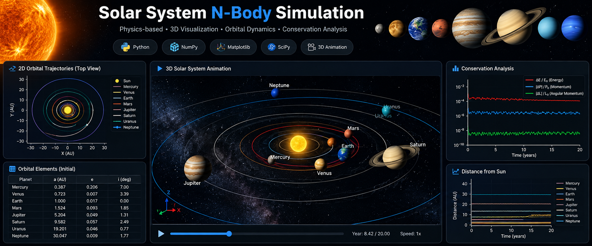

<p align="center">
  
</p>

# Solar System N-Body Simulation

A Python-based educational simulation of the Sun and eight planets using Newtonian gravitational dynamics. The program converts approximate orbital elements into Cartesian initial states, integrates the coupled equations of motion, evaluates conservation diagnostics, and visualizes the resulting trajectories in 2D and 3D.

> **Scientific scope:** This is an educational numerical model, not a precision ephemeris or an operational orbit-prediction tool. The initial orbital elements are representative values and are not tied to a documented common epoch. Results should therefore be interpreted as a demonstration of N-body dynamics rather than a reconstruction of the real Solar System at a specific date.

## Features

- Models nine bodies: the Sun and the eight planets.
- Converts orbital elements to Cartesian position and velocity vectors.
- Computes mutual Newtonian gravitational acceleration between bodies.
- Integrates the equations of motion using `scipy.integrate.solve_ivp`.
- Calculates total energy, linear momentum, angular momentum, and the system barycenter.
- Produces a full-system 2D trajectory plot and an inner-Solar-System 2D plot.
- Displays a 3D animation of planetary positions and trajectory trails.
- Includes interactive camera controls in the 3D visualization.

## Physics model

For body \(i\), the Newtonian acceleration due to all other bodies is

\[
\mathbf{a}_i =
\sum_{j\ne i}
Gm_j\frac{\mathbf{r}_j-\mathbf{r}_i}
{\lVert\mathbf{r}_j-\mathbf{r}_i\rVert^3}.
\]

The equations of motion are

\[
\frac{d\mathbf{r}_i}{dt}=\mathbf{v}_i,
\qquad
\frac{d\mathbf{v}_i}{dt}=\mathbf{a}_i.
\]

The simulation state contains the Cartesian positions and velocities of all nine bodies. Total kinetic and gravitational potential energy, total linear momentum, total angular momentum, and the barycenter are calculated during the run to help assess numerical behaviour.

## Requirements

- Python 3.10 or newer recommended
- NumPy
- SciPy
- Matplotlib

The required Python packages are listed in [`requirements.txt`](requirements.txt).

## Installation and usage

### 1. Clone the repository

After creating the GitHub repository, replace the URL below with its actual clone URL:

```bash
git clone https://github.com/sudevnprabhu-SNP/Solar-System-NBody-Simulation.git
cd Solar-System-NBody-Simulation
```

Alternatively, download the repository as a ZIP from GitHub and extract it.

### 2. Create and activate a virtual environment

**macOS / Linux**

```bash
python3 -m venv .venv
source .venv/bin/activate
```

**Windows PowerShell**

```powershell
py -m venv .venv
.\.venv\Scripts\Activate.ps1
```

### 3. Install dependencies

```bash
python -m pip install --upgrade pip
python -m pip install -r requirements.txt
```

### 4. Run the simulation

From the repository root:

```bash
python src/solar_system.py
```

The current script is configured for a 20-year integration with 4,000 output points. It prints simulation settings and conservation diagnostics, then opens the trajectory plots and 3D animation. Runtime depends on the computer and numerical solver settings.

## Controls for the 3D view

The script includes camera controls for the Matplotlib 3D animation:

- **Scroll wheel:** zoom in or out.
- **Left-click and drag:** rotate the view (depending on the Matplotlib backend).
- **Middle-click and drag:** pan the view (depending on the backend).
- **R:** reset the camera view.

Keyboard and mouse interactions can vary with the Matplotlib backend. If interactive controls do not work in your environment, try running the script with a GUI-enabled Matplotlib backend.

## Repository structure

```text
Solar-System-NBody-Simulation/
├── README.md
├── requirements.txt
├── .gitignore
└── src/
    └── solar_system.py
```

## Initial conditions and assumptions

- The Sun and eight planets are treated as point masses.
- Planetary starting states are derived from representative orbital elements in the source code.
- The elements are not documented as a mutually consistent, epoch-specific set of ephemerides.
- The model uses Newtonian gravity only.
- Planetary moons, planetary oblateness, relativistic corrections, solar radiation pressure, and spacecraft are not included.
- Any visual scaling used to make bodies or trajectories easier to see is for display only and should not be interpreted as physical scale.

## Numerical diagnostics

The script reports quantities such as:

- Initial and final total linear momentum
- Maximum relative momentum change, using the scale defined in the code
- Initial and final total energy
- Maximum relative energy error
- Initial and final angular momentum
- Maximum relative angular-momentum error
- Final barycenter and body positions

These diagnostics are useful for checking numerical behaviour, but their values depend on the initial states, solver tolerances, integration interval, and implementation. Re-run the current code before quoting numerical values. Conservation of a quantity by itself does not establish that the initial conditions accurately represent the real Solar System.

## Current limitations

1. Initial orbital elements are approximate and are not tied to a documented common epoch.
2. The simulation is intended for learning and visualization, not precision ephemeris generation.
3. The solver is a general-purpose adaptive integrator; this version does not include a systematic convergence study or a long-term symplectic integrator comparison.
4. The project does not yet include automated tests.
5. The simulation has not been independently validated against a trusted planetary ephemeris.

## Planned improvements

- Use a trusted ephemeris source to initialize all bodies at a documented common epoch.
- Validate orbital-element conversion and frame transformations with automated tests.
- Compare solver tolerances, timestep choices, and integration methods.
- Save figures and animations as reproducible output files.
- Add quantitative comparisons against reference ephemerides.
- Explore spacecraft trajectories and mission-analysis examples as a separate extension.

## Learning objectives

This project provides practice with:

- Newtonian gravitational dynamics and N-body systems
- Orbital elements and Cartesian state conversion
- Coupled ordinary differential equations and numerical integration
- Conservation-law diagnostics
- Vectorized scientific computing with NumPy
- Scientific plotting and 3D animation with Matplotlib

## License and attribution

Add a `LICENSE` file before publishing if you want to specify reuse permissions. Make sure the chosen license reflects the authorship and any third-party code or assets included in the repository.
